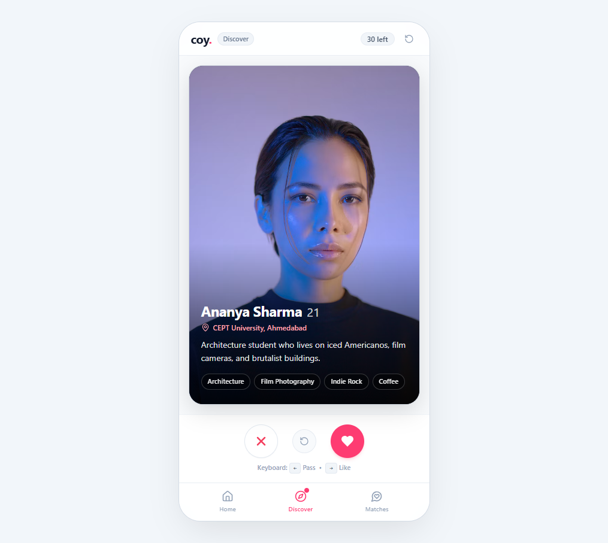
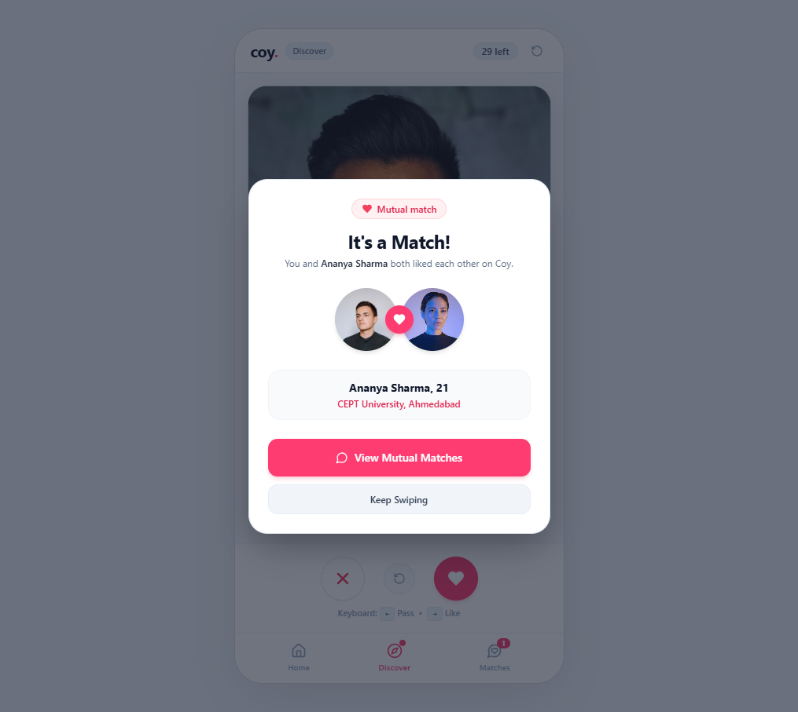
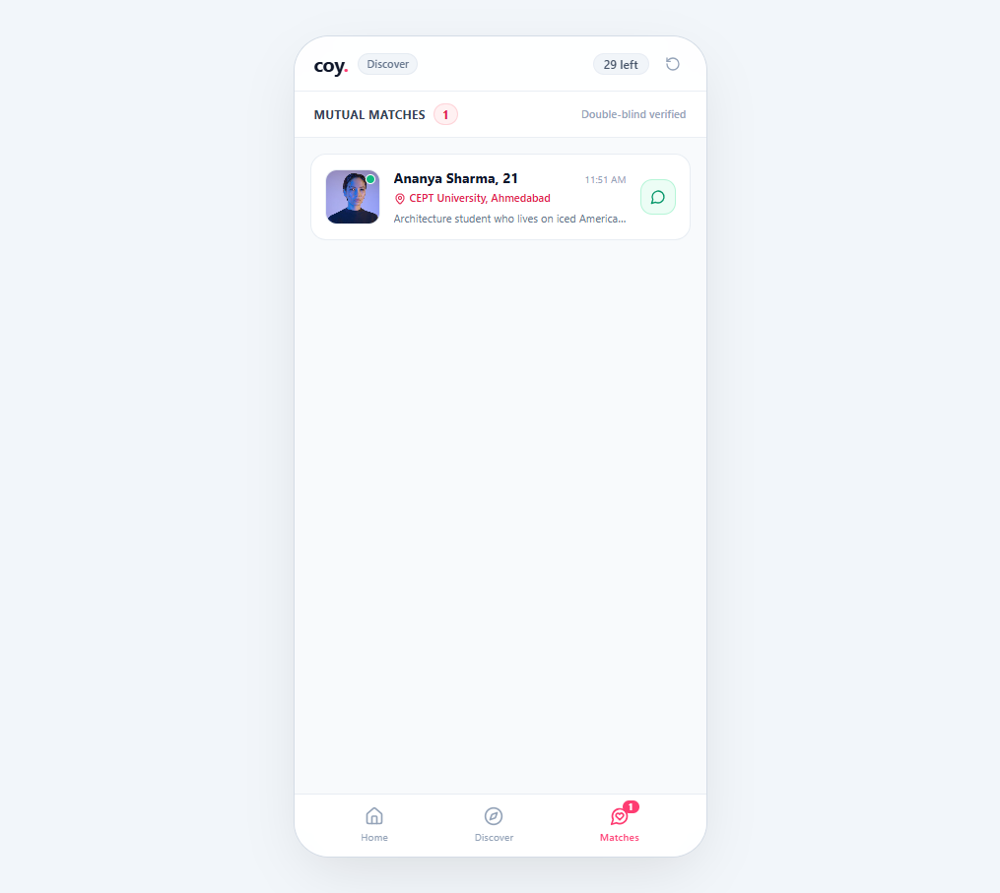

# Coy Discover — Mobile-First Swipe Deck & Product Proposal

> Standalone swipe discovery tab for **Coy** (`app.getcoy.com`), engineered with Next.js 14, Framer Motion gesture physics, and a relational SQLite backend enforcing strict Zero-Leak Privacy.

---

## Visual Showcase

| 1. Discover Swipe Deck | 2. "It's a Match!" Reveal | 3. Mutual Matches View |
| :---: | :---: | :---: |
|  |  |  |

---

## Deliverables Summary

This repository contains the complete submission for the **Coy SDE Intern Take-Home Assessment**:

1. **Part A: Product Teardown & Feature Proposals:** Full written proposal analyzing Coy's funnel drop-offs and proposing **Circle Hints** (raising invite-to-signup conversion) and **Blind Icebreaker Cards** (solving post-match conversation paralysis).  
   👉 **Read the full proposal: [PART_A_PRODUCT_PROPOSAL.md](./PART_A_PRODUCT_PROPOSAL.md)**

2. **Part B: Working Discover Tab Application:** A tactile, light-mode swipe deck featuring 30 seeded profiles, pre-liked candidate demo triggers, atomic match transactions, and persistent SQLite storage.

---

## Quickstart (Run Locally in 30 Seconds)

### Prerequisites
* Node.js v18+ (tested on Node v20 and v24)
* npm v9+

```bash
# 1. Clone repository
git clone https://github.com/HimanshuJha-2005/coy-discover.git
cd coy-discover

# 2. Install dependencies
npm install

# 3. Start development server
npm run dev
```

Open **[http://localhost:3000](http://localhost:3000)** in your browser.

* **Swipe Controls:** Drag cards left (Pass) or right (Like) on touchscreen/mouse, or use desktop buttons and keyboard arrows (`←` Pass, `→` Like).
* **Instant Demo Match:** The first candidate (`Ananya Sharma`) and 6 others have pre-liked the demo user. Swiping right immediately triggers the match celebration.
* **1-Click Reset:** Click the reset icon in the top header or empty state to instantly restore all 30 profiles.

---

## Core Engineering Highlights

### 1. The Zero-Leak Privacy Invariant (`GET /api/feed`)
The core promise of Coy is total secrecy: *never reveal who liked the user unless it is mutual*.

Returning `has_liked_you: true` in API payloads and hiding it via client CSS is a fatal privacy leak. Here, `GET /api/feed` enforces privacy at the SQL query level:

```sql
SELECT id, name, age, photo, bio, city_or_college, interests
FROM profiles
WHERE id NOT IN (
  SELECT target_profile_id FROM swipes WHERE user_id = ?
) AND id != ?
ORDER BY id ASC;
```

* Executes an **anti-join** excluding previously swiped candidates.
* **Never** joins against inbound likes.
* The HTTP response payload is mathematically incapable of leaking who has liked the user.

### 2. Atomic Transaction Match Engine (`POST /api/swipe`)
Reciprocal matching runs inside an isolated SQLite transaction:

```typescript
const transaction = db.transaction(() => {
  upsertSwipe.run(userId, targetProfileId, action);

  if (action !== 'LIKE') return { isMatch: false };

  const reciprocal = db.prepare(`
    SELECT 1 FROM swipes WHERE user_id = ? AND target_profile_id = ? AND action = 'LIKE'
  `).get(targetProfileId, userId);

  if (reciprocal) {
    // Canonical match ordering (user_1 < user_2) prevents mirror duplicate rows
    const u1 = userId < targetProfileId ? userId : targetProfileId;
    const u2 = userId < targetProfileId ? targetProfileId : userId;
    insertMatch.run(u1, u2);
    return { isMatch: true, matchProfile };
  }

  return { isMatch: false };
});
```

* **Zero Race Conditions:** The check and insertion occur atomically.
* **Canonical Uniqueness:** Enforces `UNIQUE(user_1, user_2)` where `user_1 < user_2`, preventing duplicate pairs `(A, B)` and `(B, A)`.

---

## Automated Test Suite

Run the 6 automated regression tests:

```bash
npm test
```

```text
✔ 1. Feed Anti-Join: Returns all unswiped profiles (2.5ms)
✔ 2. Zero-Leak Privacy: Feed query response contains no inbound like flags (1.0ms)
✔ 3. Pass Action: Passing on a pre-liker does NOT create a match (0.8ms)
✔ 4. Non-Mutual Like: Liking someone who has not liked you does NOT create a match (0.6ms)
✔ 5. Mutual Like: Reciprocal likes create an atomic mutual match (3.1ms)
✔ 6. Database Persistence: SQLite data persists across connection re-opens (12.7ms)
```

---

## API Reference

| Method | Endpoint | Description | Key Parameters |
| :--- | :--- | :--- | :--- |
| `GET` | `/api/feed` *(or `/feed`)* | Returns unswiped candidates for current user | `userId` (optional) |
| `POST` | `/api/swipe` *(or `/swipe`)* | Records Like/Pass; returns match evaluation | `{ targetProfileId, action }` |
| `GET` | `/api/matches` *(or `/matches`)* | Returns mutual matches with profile details | `userId` (optional) |
| `POST` | `/api/reset` *(or `/reset`)* | Resets test swipes and re-seeds demo deck | None |

---

## Tech Stack
* **Framework:** Next.js 14 (App Router & Route Handlers)
* **Frontend:** React 18, Tailwind CSS, Framer Motion (gesture physics)
* **Database:** SQLite via `better-sqlite3` (WAL mode enabled)
* **Icons:** Lucide React
* **Testing:** Native Node.js test runner (`node:test`, `node:assert/strict`)

---

**Author:** Himanshu Jha  
GitHub: [https://github.com/HimanshuJha-2005](https://github.com/HimanshuJha-2005) • LinkedIn: [https://www.linkedin.com/in/himanshu-jha-728834337/](https://www.linkedin.com/in/himanshu-jha-728834337/)
